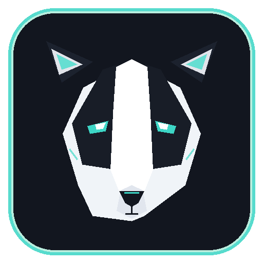

<div align="center">



# 🦡 Texugo

**Todos os seus agentes de IA de linha de comando, numa só janela.**

Claude Code · Codex · Freebuff · PowerShell · Bash · CMD — lado a lado, em terminais reais, organizados por projeto.

[](https://github.com/lucodifier/texugo/releases/latest)


[⬇ Baixar](https://github.com/lucodifier/texugo/releases/latest) · [🌐 Site](https://lucodifier.github.io/texugo/) · [Reportar problema](https://github.com/lucodifier/texugo/issues)

</div>

---

## O que é

O **Texugo** é um gerenciador desktop local para Windows. Ele **não é um agente**: não chama APIs de modelos, não pede chaves e não intermedia nada. Ele abre as CLIs que você já tem instaladas e autenticadas (`claude`, `codex`, `freebuff`…) em **terminais reais (ConPTY)**, mostra vários ao mesmo tempo numa grade e guarda tudo por projeto, para você retomar de onde parou.

## ✨ Recursos

- **Grade inteligente** – modo `AUTO` ajusta para 1, 2, 3, 4 ou 6 janelas sem espaços vazios; presets manuais disponíveis.
- **Terminais reais** – `node-pty` + ConPTY (com OpenConsole moderno embutido) e `xterm.js` com Unicode 11: sem drift de cursor, cores e prompts como no Windows Terminal.
- **Vários agentes e shells** – Claude Code, Codex, Freebuff, PowerShell, CMD, Git Bash (MINGW64) e comandos personalizados, ativáveis em *Configurações*.
- **Projetos** – cada projeto agrupa seus terminais; a barra lateral (redimensionável) mostra a **branch git** ativa e o **modelo** em uso.
- **Retomada de sessão** – ao reabrir, o histórico visual do terminal é restaurado e os agentes reconectam sozinhos (`claude --resume <id>`, `codex`, `freebuff --continue <id>`).
- **Botões rápidos** – um clique foca a sessão existente do agente no projeto em vez de criar um chat vazio.
- **Foco** – duplo clique no título maximiza um terminal; clicar na aba do projeto isola só os dele.
- **Links diretos** – clique em URLs abre no navegador padrão, sem modal de aviso.
- **Persistência local** – SQLite (`sql.js`); nada sai da sua máquina.

## 🚀 Instalação

1. Baixe o `Texugo-Setup-0.1.0.exe` em **[Releases](https://github.com/lucodifier/texugo/releases/latest)**.
2. Execute o instalador (Windows 10/11 x64; permite escolher a pasta, cria atalhos).
3. Tenha ao menos uma CLI de agente instalada e logada (ex.: `claude`).

> O instalador ainda não é assinado digitalmente; o Windows SmartScreen pode exibir um aviso — use *Mais informações → Executar assim mesmo*.

## 🧑‍💻 Desenvolvimento

Requisitos: Node.js 20+, Windows, Git (para o Bash).

```powershell
git clone https://github.com/lucodifier/texugo.git
cd texugo
npm install
npm run dev        # modo desenvolvimento
npm test           # testes (vitest)
npm run dist       # gera o instalador em release/
```

### Estrutura

```
electron/   processo principal: PTY, banco, IPC, descoberta de sessões
src/        interface React (grade, sidebar, terminais, configurações)
shared/     tipos, layout, defaults e lógica de resume compartilhados
tests/      testes de banco, layout e resume
landing/    site (Dachshund Framework) publicado no GitHub Pages
```

## 🗺️ Roadmap

Projeto em evolução ativa. Ideias em andamento: mais agentes embutidos, assinatura de código do instalador, builds para macOS/Linux e histórico de conversas pesquisável.

## 🛠️ Stack

Electron · React 18 · TypeScript · Tailwind CSS 4 · Zustand · xterm.js · node-pty (ConPTY) · sql.js · Vitest · electron-builder

## 📄 Licença

MIT © [CodeHolistic](https://github.com/lucodifier)
